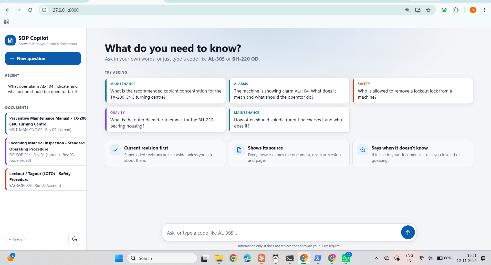
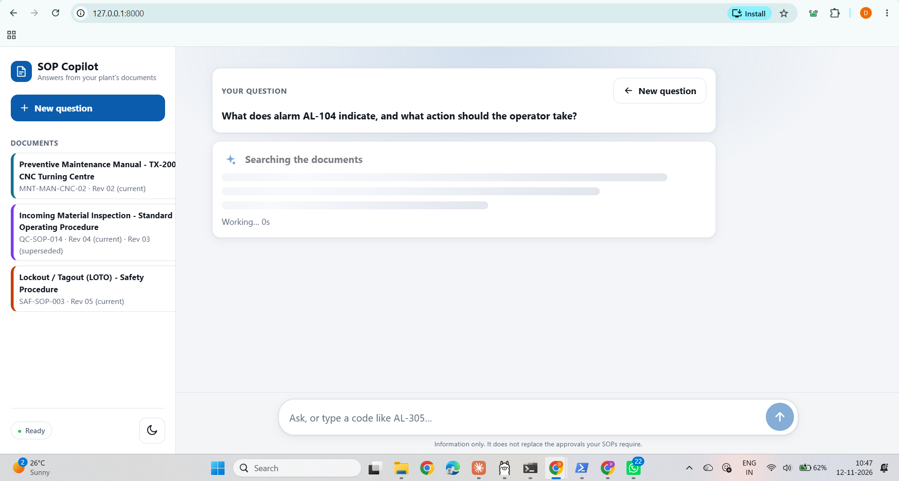
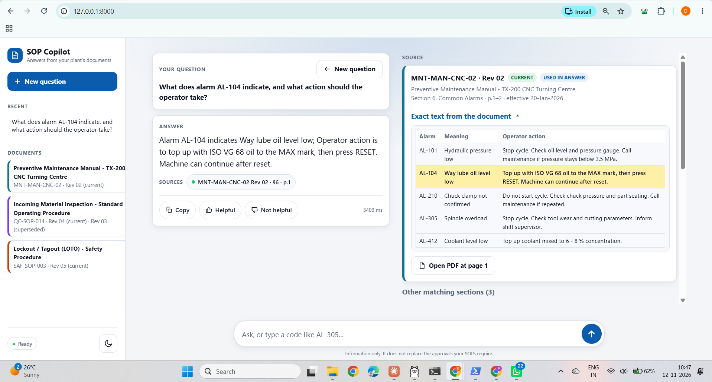
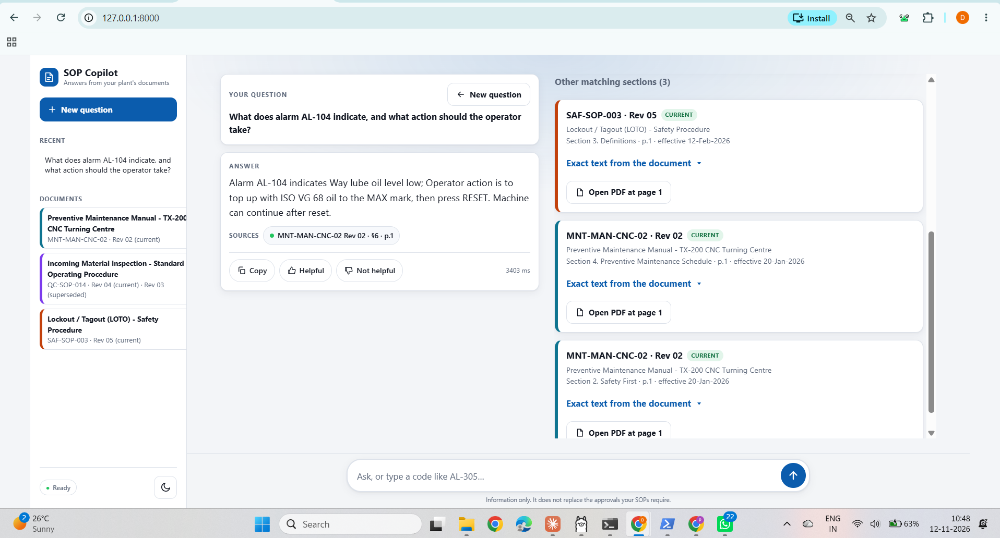
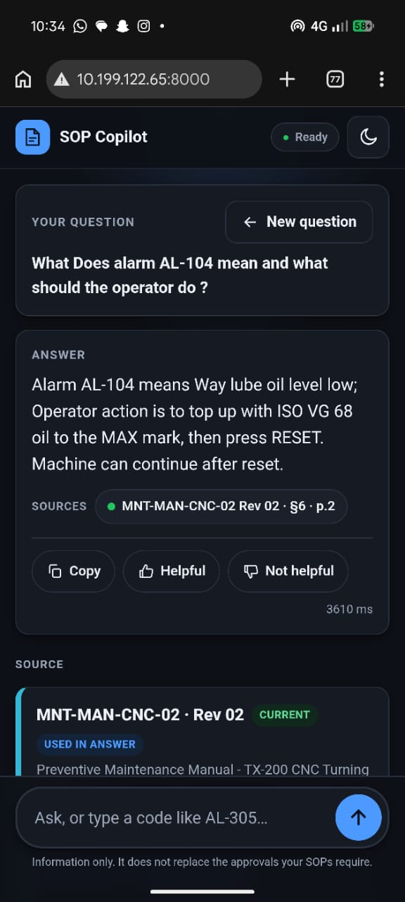
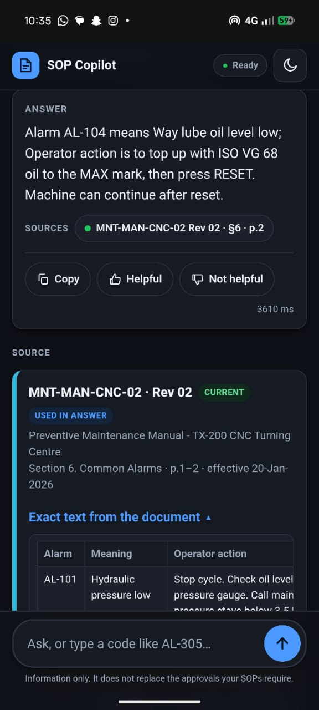
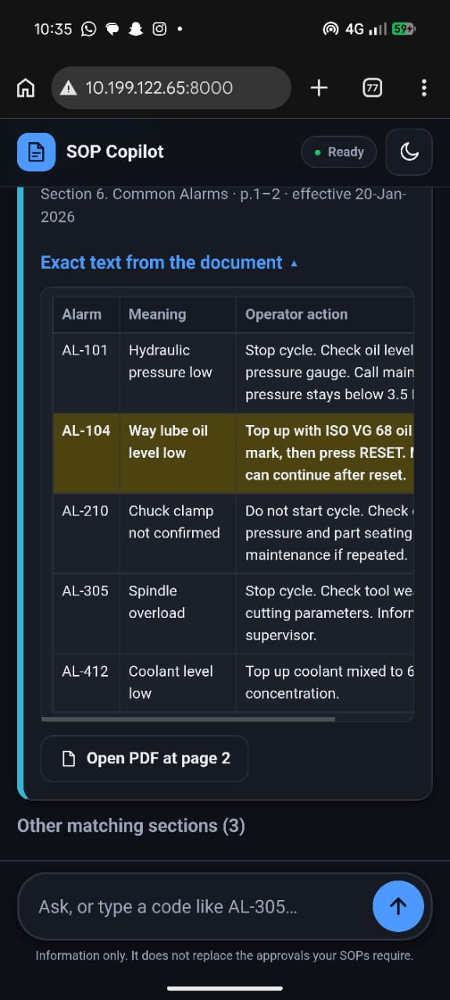

# SOP Copilot

A mobile-friendly question-answering app for shop-floor supervisors. It answers from the plant's SOPs and
manuals (4 PDFs in `Files/`), shows the exact source (document, **revision**, section, page, text), says so
when the answer is not in the documents, and always prefers the **current** revision.

Stack: FastAPI, PyMuPDF, `bge-small-en-v1.5` embeddings, BM25 + vector search fused with RRF, Ollama (`qwen2.5:3b`, a 1.9 GB model that runs well on a 6 GB laptop GPU), plain HTML/JS UI.
Why these choices, and what I left out: see [FINAL_PLAN.md](FINAL_PLAN.md) and [THINKING.md](THINKING.md).

## What it looks like

**Desktop** (sidebar with documents and their revisions; the answer on the left, the exact evidence on the right):







The app also lists the other sections it considered, collapsed under "Other matching sections", each with its own page link:



**Phone**, opened over the same Wi-Fi at `http://<laptop-ip>:8000` (a real phone, not an emulator). Same question, same answer, with the exact table row highlighted and a link to PDF page 2:

<table>
  <tr>
    <td></td>
    <td></td>
    <td></td>
  </tr>
</table>

## Setup (Windows, Python 3.11)

```bash
python -m venv .venv
.venv\Scripts\activate
pip install -r requirements.txt
ollama pull qwen2.5:3b           # about 1.9 GB; set OLLAMA_MODEL in .env to try a bigger one (llama3.1:8b, qwen2.5:7b)
python -m app.ingest.build_index # parses the PDFs and builds the index (first run downloads a 130 MB embedding model)
uvicorn app.main:app --host 0.0.0.0 --port 8000
```

**Starting it every time** (PowerShell, from the project folder; Ollama must be running, which it is by default after installing the Ollama app):

```powershell
cd E:\BIZTELAI_Project
.\.venv\Scripts\python.exe -m uvicorn app.main:app --host 0.0.0.0 --port 8000
```

Stop it with `Ctrl+C`. If `index/` is missing (it is not stored in git), run `python -m app.ingest.build_index` first.

Open `http://localhost:8000`. Without the Ollama model the app still runs in **search-only mode**: it shows the
matching document sections and the status pill says "AI offline: search only".

Optional settings go in `.env` (see `.env.example`).

## Open it from your phone (same Wi-Fi)

1. Start the server with `--host 0.0.0.0` (as above). The default `127.0.0.1` is the usual reason a phone cannot connect.
2. Find the laptop's IP: `ipconfig` → "Wi-Fi" → IPv4 address (on my laptop it was `10.199.122.65`).
3. Allow the port through Windows Firewall (run PowerShell **as Administrator** once; Windows marks home Wi-Fi as "Public" by default, which blocks inbound traffic):
   ```powershell
   New-NetFirewallRule -DisplayName "SOP Copilot 8000" -Direction Inbound -Protocol TCP -LocalPort 8000 -Action Allow -Profile Any
   ```
4. On the phone (same Wi-Fi) open `http://<laptop-ip>:8000`.
5. If it still does not load, the router may isolate clients (common on office/college Wi-Fi). Use the phone's hotspot and connect the laptop to it.
6. The server loads the model at startup, so the first question is not slow. Plug the laptop in: on battery the GPU slows down and answers took 14 s instead of 3 s in my tests.

What happened for me: Windows had no inbound rule for port 8000 and marks my Wi-Fi as "Public", so I added the rule above. After that the app loaded on my phone at `http://10.199.122.65:8000`, and my phone's browser shows "Not secure" only because this is plain HTTP on the local network (see the screenshots above).

## How it answers

```
question → normalise ("al305" → "AL-305", "OD" → "outer diameter")
         → unknown-code check (AL-999 is in no document → "not found", no LLM call)
         → hybrid retrieval: BM25 + vectors, rank fusion, current revisions only (top 4)
           + linked documents (hose replacement pulls in the lockout SOP)
         → loose relevance gate (nothing resembles the question → "not found")
         → LLM answers only from numbered excerpts, returns JSON {answerable, answer, exceptions, citations}
         → citation check (the answer text must really appear in the cited section; no valid citation → "not found")
         → second look: if retrieval is very confident but the model refused, ask once more (the citation check still applies)
         → required evidence: a rule and its exception are always shown together, word for word
         → matching table row: for lookups (tolerance, alarm, schedule) the row is copied from the PDF with its column labels
         → answer + source cards (revision badge, section, page, exact text, "Open PDF at page N")
```

**Required evidence for safety rules (deterministic, not left to the model).** Some sections are the exception to a rule in another section: "5. Removing Locks" says each person removes only their own lock, and "6. Removal of a Lock When the Owner Is Absent" says what happens when the owner has left. A small model may quote only the rule. So at ingest the app detects exception sections from their headings and links each to the rule it qualifies (by the heading's topic words, within the same document and revision). At answer time, whenever either half is cited, **both halves are pulled into the model's context and shown verbatim in amber blocks under the answer**, whatever the model wrote. In the evaluation this showed the exception in 2/2 lockout questions, while the model's own answer text contained it in 0/2. Limit: it only recognises exceptions that are written as their own section with a telling heading ("When…", "If…", "Absent", "Emergency").

**Matching table row (also deterministic).** The 1.9 GB model sometimes words a table lookup badly or slips a digit (`0.05` for `0.050`, "quarterly" for monthly). So for questions that point at one table row (an alarm code, a tolerance, a schedule line), the app picks the row itself, by the code or by words shared with that row and no other, and shows it with its column labels, for example `Characteristic: Outer diameter | Tolerance: +/- 0.050 | Method: Digital caliper | Class: Major`. It shows nothing when the answer is prose or when two rows tie.

**The improvement I added: revision awareness.** `QC-SOP-014` is supplied twice (Rev 03 from 2023 and Rev 04 from 2026)
and they disagree (sample size, quarantine location, form, escalation, certificate rule). Each chunk carries its
revision and status; superseded chunks are excluded unless the question asks about an old revision; every source
shows its revision and effective date, and superseded sources carry a red warning. Safety-related answers
(lockout, stored energy) also get a "confirm against the SOP page" banner.

Chunking: one chunk per numbered section, tables kept whole as Markdown with their header row, tables that run onto the next page merged, page recorded per line (so AL-104 links to page 2). 28 chunks in total.

## Endpoints

`POST /api/ask` · `POST /api/feedback` (thumbs up/down on an answer) · `GET /api/documents` · `GET /api/pdf/{file}#page=N` · `GET /api/health` · interactive docs at `/docs`.
Every request appends a line to `logs/trace.jsonl` (question, retrieved chunks with scores, mode, latency); feedback goes to `logs/feedback.jsonl`, keyed by the same `trace_id`.

The UI is plain HTML/CSS/JS in `app/static/` (no build step). Its patterns (thinking indicator, rounded prompt bar, source chips, answer action row) were chosen after browsing 21st.dev's AI-chat components and re-written by hand.

## Evaluation

```bash
python -m eval.run_eval      # writes eval/results.md and eval/results.json
```

Full results are in [eval/results.md](eval/results.md) (24 questions over 7 pages: a sanity check, not a benchmark). With `qwen2.5:3b`:

| Measure | Result |
|---|---|
| Retrieval: right evidence in the top 4 (mine vs a fixed 500-character chunking baseline) | 100% vs 81% |
| Key facts visible on screen (the AI's answer + the table row and exception the app copies from the document) | 18/18 (100%) |
| ...the AI's own sentence alone | 15/18 (83%) |
| Answer cites a source that contains the evidence | 18/18 (100%) |
| Answered an unanswerable question (false accept) | 0/6 |
| Refused an answerable question (false reject) | 0/18 |
| Answer used the superseded Rev 03 | 0/17 |
| "Open PDF at page N" points to the right page (answers that sit on page 2) | 5/5 |
| Rule's exception shown next to the answer (enforced by the app) | 2/2 (the AI's own text had it 0/2) |
| Exception blocks shown on unrelated questions | 0 |
| Answer time, median / slowest | 2.5 s / 5.3 s plugged in (14 s median when the laptop ran on battery) |

Read the first two rows together: the 100% includes blocks the app copies verbatim from the PDF, which is the point of the design, but the model on its own gets 15 of 18. In the last check its three misses were: the lockout question (it wrote "the Shift Supervisor and Production Manager with Safety Officer's approval are allowed to remove a lock", which mis-states the rule), the bare code `AL-305` (the action but not the meaning), and the `bh220 od` query (it dropped the trailing zero and added the wrong row). That is why the app shows the SOP's own words for the lockout rule and the matching table row for lookups, and keeps the AI's sentence for lockout collapsed and labelled "not verified". Results move by a question or two between runs even with temperature 0 and a fixed seed (earlier AI-only scores were 14 to 16 of 18), so treat them as a range, not a precise figure. I tuned the app while looking at these questions, so they are optimistic.

## My 5 questions and the app's answers

Sample questions are in `Files/Sample_Questions.pdf`. My own five, with one the documents cannot answer:

| # | Question | Why I chose it | App's answer |
|---|---|---|---|
| 1 | How many samples do I need to inspect from a lot of 200 pieces? | Rev 03 says 5, Rev 04 says 13 | "Samples to inspect: 13." Source: QC-SOP-014 **Rev 04** §4, p.1 (the current revision, not Rev 03's 5). |
| 2 | How do I replace a hydraulic hose? | Needs two documents; must include lockout | The full 5-step procedure: isolate per SAF-SOP-003 and release stored hydraulic pressure, confirm the gauge reads zero, drip tray, fit the new hose, remove locks and check 3.5 - 4.0 MPa. Source: MNT-MAN-CNC-02 §7, p.2. |
| 3 | Where do I put rejected material? | Rev 03 and Rev 04 differ | "Tagged with a RED tag and moved to Quarantine Cage Q1, Stores Bay 3. The cage is locked; the key is held by the Shift QC Supervisor." Source: QC-SOP-014 **Rev 04** §5, p.2 (Rev 03's Red Bin near Gate 2 is superseded). |
| 4 | What happens if the material test certificate is missing? | Rule changed in Rev 04 | "The lot is put on HOLD and must not be inspected or accepted until the MTC is received." Source: QC-SOP-014 **Rev 04** §5, p.2. |
| 5 | What is the maximum spindle speed of the TX-200? | Plausible but **not in the documents** | **Not found in the plant documents.** The app refuses to guess, suggests "Ask the maintenance engineer, or your shift lead", and offers the closest documents. |

## Known limits

- Seven pages is not a real knowledge base; thresholds are tuned on a handful of questions.
- Questions that are close to the documents but not covered (e.g. "overheating warning") are caught by the LLM's refusal and the citation check, not by the gate; this held in all 6 test cases, but it depends on a small model behaving.
- The AI's own short answer can still be incomplete (for the lockout question it states only the rule). That is why safety exceptions are enforced by the app and shown verbatim, not trusted to the model.
- The 5 questions in the table above were picked by me from the eval's candidate set; the app's answers were produced by the running app.
- English only. No login, no history, no offline cache.
- Information only: it does not replace the approvals the SOPs require.
